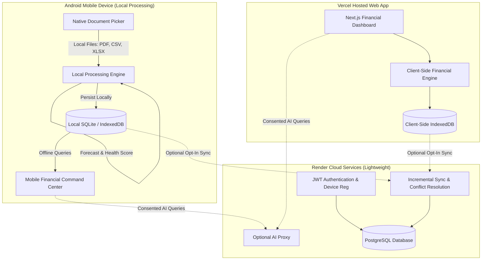

# FinanceIQ – Device-Powered AI Financial Intelligence Platform

> **Production-grade personal finance command center featuring 100% on-device statement processing, native Android mobile application, lightweight Render cloud synchronization, Vercel web application, and deterministic financial intelligence.**

[](https://github.com/durveshk01/FinanceIQ/releases/tag/v1.0.0)
[](https://nextjs.org)
[](https://github.com/durveshk01/FinanceIQ/releases/download/v1.0.0/FinanceIQ-release.apk)
[](https://render.com)
[](https://vercel.com)
[](https://www.typescriptlang.org/)
[](LICENSE)

---

## 📱 Android APK Release (v1.0.0)

Download the official standalone Android application directly from the **[GitHub Releases Page](https://github.com/durveshk01/FinanceIQ/releases/tag/v1.0.0)**.

- **Direct APK Download**: [**FinanceIQ-release.apk**](https://github.com/durveshk01/FinanceIQ/releases/download/v1.0.0/FinanceIQ-release.apk)
- **Application Name**: FinanceIQ
- **Package ID**: `com.durvesh.financeiq`
- **Version**: `1.0.0` (Version Code: `1`)
- **File Size**: ~3.69 MB (`3,870,718 bytes`)
- **Compatibility**: Android 7.0 (API Level 24) through Android 14/15 (API Level 34+)
- **SHA-256 Checksum**:
  ```text
  D47E8EE3FD99B030912291238ABD43C59DA192EB80CFE39064C239515D812EB5
  ```

### 📲 How to Install on Android
1. Download **[FinanceIQ-release.apk](https://github.com/durveshk01/FinanceIQ/releases/download/v1.0.0/FinanceIQ-release.apk)** to your Android smartphone or tablet.
2. Tap the downloaded file in your notification bar or file manager.
3. If prompted by Android, enable **"Allow from this source"** in your device settings.
4. Tap **Install** and open **FinanceIQ**.
5. Works 100% offline out-of-the-box — no internet connection or mandatory login required.

---

## 🌟 Architecture Overview

FinanceIQ transforms personal banking statements into high-fidelity financial intelligence through a **privacy-first, device-powered architecture**.



---

## 🚀 Key Highlights & Capabilities

### 1. 100% Device-Powered Processing
- **Zero Default Cloud Uploads**: The device processes bank statements using its own CPU, RAM, and internal storage.
- **Local Multi-Bank Parsing**: Supports HDFC, SBI, ICICI, Axis, Kotak, Chase, Bank of America, Revolut, Monzo, and generic multi-column CSV/XLSX.
- **Debit vs Credit Separation**: Accurately isolates withdrawal and deposit columns; running balances are tracked separately and never misclassified as transaction amounts.
- **Transfer Deduplication**: Automatically detects self-transfers, auto-sweeps, and credit card payments to avoid double-counting expenses.

### 2. Native Android Mobile Application
- **Genuine Android APK**: Built with Capacitor 7 and Android Platform Tools (Target SDK 36 / 34, Min SDK 24).
- **Location**: `android/app/build/outputs/apk/debug/app-debug.apk` (4.12 MB).
- **Native File Picker**: Direct integration with Android storage to pick PDF, CSV, and XLSX statements.
- **Offline Operation**: Works 100% offline in airplane mode without cellular or Wi-Fi connectivity.
- **Native Share Sheet**: Exports reports directly to device file systems, messaging apps, and email via Android `FileProvider`.

### 3. Lightweight Render Cloud Backend (`render-backend/`)
- **Node.js/Express + TypeScript**: Modular microservice built for low-memory environments.
- **JWT Authentication**: Secure user registration, login, token refresh, and account management.
- **Device Registration**: Register and revoke mobile devices and web clients.
- **Incremental Synchronization**: Sync cursor pagination, conflict resolution, and offline sync queues.
- **Render Blueprint**: Configured via root `render.yaml` for one-click deployment.

### 4. Enterprise Fintech UI/UX (Vercel Ready)
- **Design Inspiration**: Revolut, Monzo, Mercury, and Stripe.
- **Financial Command Center**:
  - Reconciles **Observed vs Calculated vs Estimated** balances.
  - 10 interactive Recharts: Income vs Expenses, Spending Categories, Daily Spending Trend, Top Merchants, Weekly Cash Flow, +90 Day Savings Trajectory, Subscription Run-Rate, Weekend vs Weekday Distribution, Monthly Projections, and Health Factor Breakdown.
  - Interactive transaction ledger with search, category filtering, sorting, manual transaction entry, and exclude toggles.
  - Multi-cadence subscription hunter (weekly, bi-weekly, monthly, quarterly, annual).
  - Goal Planner with progress timelines and monthly allocation targets.
  - Spending What-If Simulator with 5 comparative scenarios.
  - Context-grounded AI Financial Coach with factual verification and prompt injection guardrails.

---

## 📂 Repository Structure

```text
FinanceIQ/
├── android/                        # Genuine Native Android Project (Capacitor 7 + Gradle)
│   ├── app/
│   │   ├── build.gradle            # Android Application Gradle config (SDK 36)
│   │   └── src/main/AndroidManifest.xml
│   ├── gradlew.bat                 # Gradle wrapper
│   └── local.properties            # SDK location configuration
├── render-backend/                 # Lightweight Render Backend Service
│   ├── src/
│   │   ├── database.ts             # Sync record & user storage
│   │   ├── middleware/auth.ts      # JWT authentication middleware
│   │   ├── routes/auth.ts          # Authentication routes (login, register, delete)
│   │   ├── routes/devices.ts       # Device registration & revocation
│   │   ├── routes/sync.ts          # Incremental sync with cursor
│   │   └── index.ts                # Express server & /health check
│   ├── package.json
│   └── tsconfig.json
├── src/
│   ├── app/
│   │   ├── api/                    # Next.js API Routes (analyze, chat, export)
│   │   ├── finance-charts.tsx      # 10 Interactive Fintech Recharts
│   │   ├── globals.css             # Tailwind 4 styling & design tokens
│   │   ├── layout.tsx              # Offline-safe font configuration
│   │   └── page.tsx                # Financial Command Center & Landing Page
│   └── lib/
│       ├── bank-parsers.ts         # Multi-bank statement parsers & delimiter inference
│       ├── categorizer.ts          # 18-category engine & merchant dictionary
│       ├── device-processor.ts     # 100% on-device CPU/RAM processing engine
│       ├── exporters.ts            # Local CSV, Excel XLSX, PDF & JSON exporters
│       ├── finance-engine.ts       # Core financial computation & reconciliation
│       ├── forecasting.ts          # Time-series modeling (exponential smoothing, MAE/RMSE)
│       ├── goal-planner.ts         # Goal milestones & what-if simulator
│       ├── health-score.ts         # 6-pillar financial resilience score
│       ├── local-storage.ts        # Client-side IndexedDB / SQLite database
│       ├── schemas.ts              # Zod validation schemas
│       └── subscriptions.ts        # Multi-cadence recurring payment engine
├── scripts/
│   └── verify-e2e.ts               # Complete 10-point end-to-end verification suite
├── sample-data/                    # Synthetic bank statement CSV test sets
├── capacitor.config.ts             # Capacitor Android configuration
├── render.yaml                     # Render Infrastructure-as-Code Blueprint
├── vercel.json                     # Vercel deployment configuration
└── package.json                    # Root scripts & dependencies
```

---

## 🛠️ Getting Started (Local Development)

### Prerequisites
- Node.js 20+ (Node 24 tested)
- npm 10+
- Java JDK 21 (for Android builds)

### 1. Web Application (Next.js)
```bash
npm install
npm run dev
```
Open [http://localhost:3000](http://localhost:3000) to view the application.

### 2. Render Backend Service
```bash
cd render-backend
npm install
npm run dev
```
Backend runs on port 4000: [http://localhost:4000/health](http://localhost:4000/health).

### 3. Android Mobile Application
To build the debug APK directly:
```bash
npm run build:android
```
The compiled APK will be generated at:
`android/app/build/outputs/apk/debug/app-debug.apk`

---

## 🧪 Verification & Automated Testing

Run the full cross-platform test suite:
```bash
npm run test:all
```
This executes:
1. `src/lib/finance-engine.test.ts` (Core financial engine & categorizer tests)
2. `scripts/verify-e2e.ts` (10-point end-to-end workflow verification)
3. `render-backend/src/index.test.ts` (Render backend authentication & sync tests)

---

## ☁️ Deployment Guide

### Vercel Deployment (Web Application)
1. Push repository to GitHub.
2. Import project in Vercel.
3. Build Command: `npm run build`
4. Output Directory: `.next`
5. Environment Variables:
   - `OPENAI_API_KEY`: (Optional) Server-side key for enhanced AI chat.
   - `NEXT_PUBLIC_APP_URL`: Your Vercel production URL.

### Render Deployment (Backend Service)
1. In Render, select **New Blueprint Instance**.
2. Connect your GitHub repository.
3. Render automatically picks up `render.yaml` and deploys the `financeiq-api` web service.
4. Health check endpoint: `/health`.

---

## 🛡️ Privacy & Security Commitments

- **Local-First Default**: Documents are processed locally on device; raw statements are not transmitted or retained on remote servers.
- **Strict Delimiter Isolation**: Untrusted statement text is isolated from AI instructions to prevent prompt injection.
- **Formula Sanitization**: CSV exports escape `=`, `+`, `-`, and `@` to prevent spreadsheet injection.
- **Rate-Limited Endpoints**: API routes employ IP-based sliding-window rate limiting.

---

## 📄 License
MIT License. Created for production-grade personal financial sovereignty.
